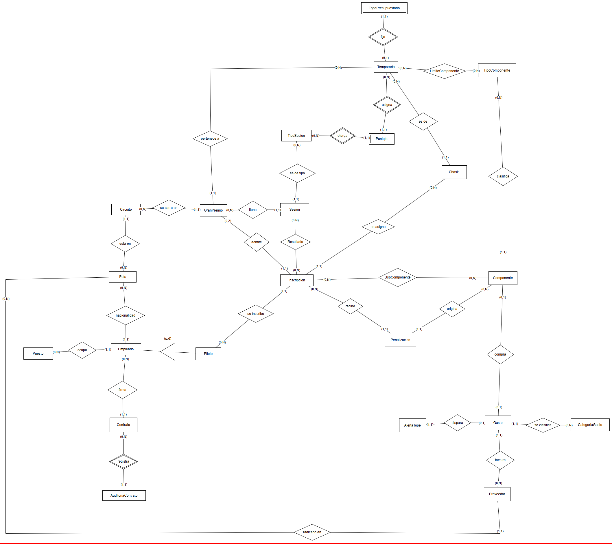
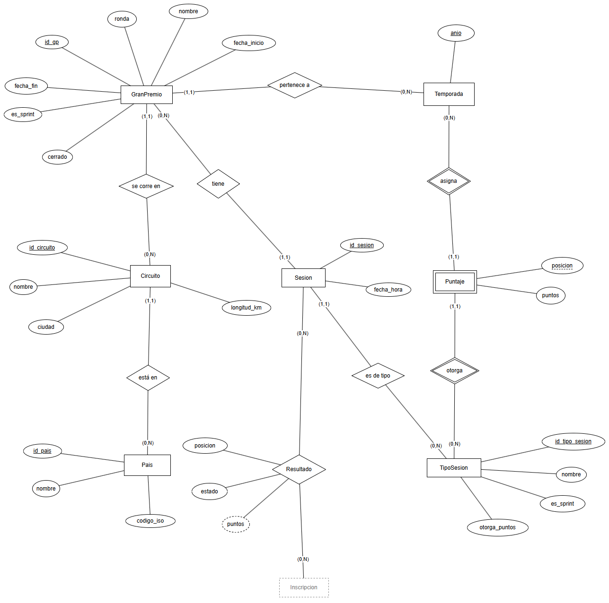
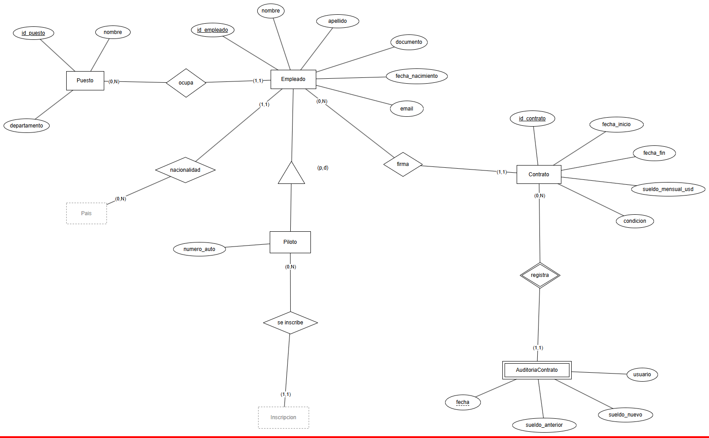
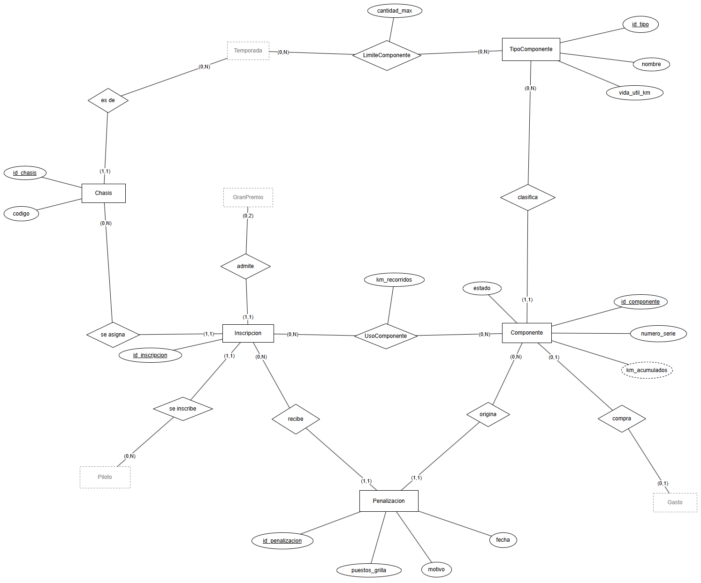
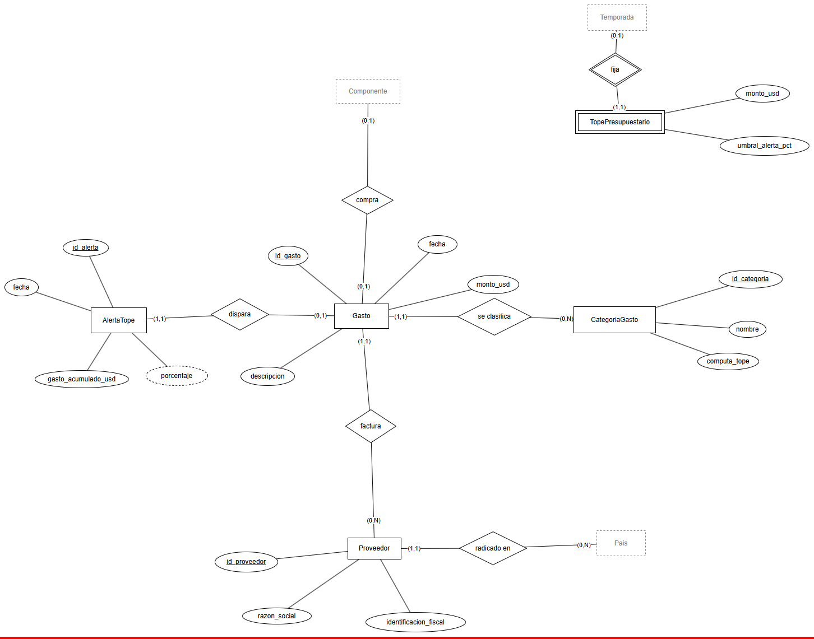

# DER

El DER está hecho en draw.io: [der/der.drawio](der/der.drawio). Tiene cinco pestañas. La primera es el modelo entero sin atributos, para ver cómo se conecta todo, y las otras cuatro son una por área con todos los atributos.

usamos la notación de Chen que vimos en clase.

## Cómo se lee

- Rectángulo: entidad. Rectángulo doble: entidad débil.
- Rombo: relación. rombo doble: relación identificadora (la que le da la identidad a una entidad débil).
- Elipse: atributo. Si está subrayado es el identificador de la entidad. Subrayado punteado es la clave parcial de una entidad débil.
- Elipse punteada: atributo derivado, o sea que se puede calcular a partir de otros datos.
- El triángulo es una especialización ("es un").
- En las páginas por área, las cajas grises punteadas son entidades de otra área. Están para que se vea con quién se conecta, sus atributos aparecen en su propia página.

Las cardinalidades están como (mín,máx) al lado de cada entidad, y dicen en cuántas ocurrencias de esa relación participa cada ocurrencia de la entidad. Por ejemplo en "GranPremio (0,N) tiene (1,1) Sesion":

- un Gran Premio tiene entre 0 y N sesiones (0 porque se puede cargar el GP antes de armar el cronograma).
- una sesión es de exactamente un Gran Premio.

## Modelo general

Son 22 entidades y tres relaciones N:M que tienen atributos propios (Resultado, LimiteComponente y UsoComponente). Cuando se pasa a tablas eso da las 25 tablas del modelo.

## Por área

### Deportiva

Temporada se identifica por el año, no le inventamos un id.

Puntaje es débil. Un puntaje solo existe para una temporada y un tipo de sesión, y se identifica por esos dos más la posición (su clave parcial). La tabla de puntos cambia según la temporada y según si es carrera o sprint, por eso depende de las dos.

Resultado es una relación N:M entre Sesion e Inscripcion: en una sesión hay resultados de varios pilotos inscriptos, y un piloto inscripto tiene resultado en varias sesiones del fin de semana. tiene sus propios atributos, posicion y estado (Finalizó, Abandono, Descalificado, No largó). `puntos` está como derivado porque no lo guardamos, sale de cruzar la posición con Puntaje.

### Personal

Piloto es una especialización de Empleado. Un piloto es un empleado con un dato más, el número de auto. La marcamos (p,d):

- parcial, porque hay empleados que no son pilotos (ingenieros, mecánicos, administrativos).
- disjunta, porque solo hay un subtipo y no se puede ser piloto "dos veces".

AuditoriaContrato es débil, depende de Contrato. Un registro de auditoría no tiene sentido sin el contrato al que le cambiaron el sueldo. su clave parcial es la fecha y hora del cambio. En la tabla igual le pusimos un `id_auditoria` propio, porque dos cambios en el mismo segundo romperían la clave y un id es más simple de manejar.

### Técnica

Inscripcion es la entidad que más se conecta. Salió de una relación N:M entre Piloto y GranPremio (un piloto corre muchos GP, un GP lo corren dos pilotos), pero además de unir a los dos lleva el chasis, y de ella cuelgan los resultados, el uso de piezas y las penalizaciones. por eso la dibujamos como entidad y no como rombo.

La cardinalidad (0,2) del lado de GranPremio en "admite" es la regla de que corren dos autos por equipo (RN03).

LimiteComponente es N:M entre Temporada y TipoComponente con el atributo cantidad_max: cuántas piezas de ese tipo se permiten en esa temporada.

UsoComponente es N:M entre Componente e Inscripcion. Guarda los km que hizo cada pieza en cada Gran Premio.

`km_acumulados` de Componente está punteado porque es derivado: es la suma de los km de UsoComponente. Igual lo guardamos en la tabla, es una desnormalización hecha a propósito y está explicada en la sección de normalización.

### Finanzas

TopePresupuestario es débil respecto de Temporada. hay un tope por año, y el tope se identifica por el año de su temporada, no tiene identificador propio.

La relación "compra" entre Gasto y Componente es (0,1) de los dos lados. No todo gasto es una pieza (hay fletes, servicios, etc.) y una pieza puede no tener gasto cargado, por ejemplo si vino de una temporada anterior. Lo que no puede pasar es que una pieza tenga dos gastos de compra (RN17).

En AlertaTope el porcentaje es derivado (gasto acumulado sobre el tope del año), así que no lo guardamos. Se calcula en la vista.

## Cardinalidades

| Relación | Entidad A | Card. A | Entidad B | Card. B |
|---|---|---|---|---|
| está en | Circuito | (1,1) | Pais | (0,N) |
| se corre en | GranPremio | (1,1) | Circuito | (0,N) |
| pertenece a | GranPremio | (1,1) | Temporada | (0,N) |
| tiene | Sesion | (1,1) | GranPremio | (0,N) |
| es de tipo | Sesion | (1,1) | TipoSesion | (0,N) |
| asigna | Puntaje | (1,1) | Temporada | (0,N) |
| otorga | Puntaje | (1,1) | TipoSesion | (0,N) |
| Resultado | Sesion | (0,N) | Inscripcion | (0,N) |
| nacionalidad | Empleado | (1,1) | Pais | (0,N) |
| ocupa | Empleado | (1,1) | Puesto | (0,N) |
| firma | Contrato | (1,1) | Empleado | (0,N) |
| registra | AuditoriaContrato | (1,1) | Contrato | (0,N) |
| se inscribe | Inscripcion | (1,1) | Piloto | (0,N) |
| admite | Inscripcion | (1,1) | GranPremio | (0,2) |
| es de | Chasis | (1,1) | Temporada | (0,N) |
| se asigna | Inscripcion | (1,1) | Chasis | (0,N) |
| LimiteComponente | Temporada | (0,N) | TipoComponente | (0,N) |
| clasifica | Componente | (1,1) | TipoComponente | (0,N) |
| UsoComponente | Componente | (0,N) | Inscripcion | (0,N) |
| recibe | Penalizacion | (1,1) | Inscripcion | (0,N) |
| origina | Penalizacion | (1,1) | Componente | (0,N) |
| fija | TopePresupuestario | (1,1) | Temporada | (0,1) |
| se clasifica | Gasto | (1,1) | CategoriaGasto | (0,N) |
| factura | Gasto | (1,1) | Proveedor | (0,N) |
| radicado en | Proveedor | (1,1) | Pais | (0,N) |
| compra | Gasto | (0,1) | Componente | (0,1) |
| dispara | AlertaTope | (1,1) | Gasto | (0,1) |

casi todos los mínimos del lado "muchos" son 0 a proposito. Así se puede cargar un circuito antes de que tenga Grandes Premios, un puesto antes de contratar a alguien, etc.

Hay dos reglas que el DER no alcanza a mostrar y que se controlan en la base:

- que el resultado y la inscripción sean del mismo Gran Premio (la sesión es de un GP y la inscripción también, tienen que coincidir). Lo valida el procedimiento de carga de resultados.
- que el chasis sea de la misma temporada que el Gran Premio (RN06). lo valida el procedimiento de inscripción.
