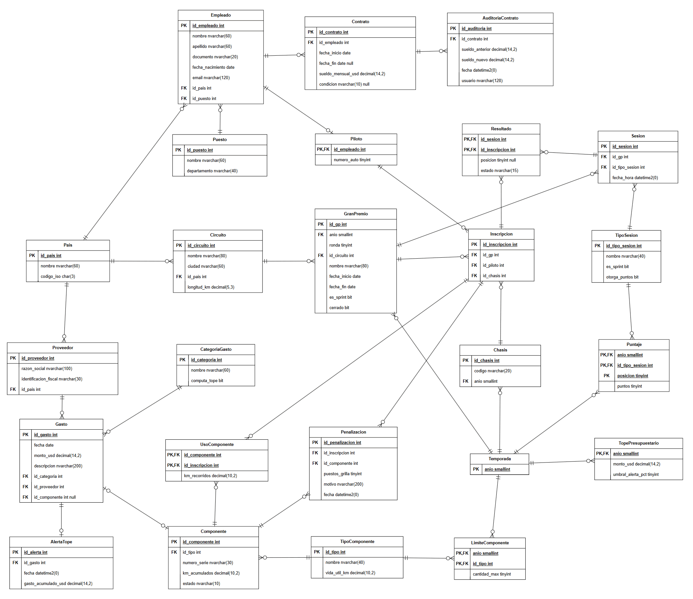

# Modelo de tablas y diccionario de datos

## Modelo de tablas

Son las 25 tablas como quedaron en la base, con sus columnas, tipos y claves. Está en draw.io: [tablas/modelo_tablas.drawio](tablas/modelo_tablas.drawio).

Cómo se lee:

- PK es la clave primaria y FK una clave foránea. Si dice PK,FK la columna es las dos cosas, como en Piloto o en las tablas con clave compuesta.
- Las líneas unen cada clave foránea con la tabla a la que apunta. Del lado de muchos va la pata de gallo, del lado de uno las dos rayitas.
- Tres relaciones son de uno a uno: Piloto con Empleado (la especialización), AlertaTope con Gasto (un gasto dispara como mucho una alerta) y Gasto con Componente (una pieza tiene como mucho un gasto de compra, RN17). Por eso esas tienen un círculo y una raya en vez de pata de gallo.
- `null` al lado del tipo quiere decir que la columna acepta nulos. Son solo cuatro: `fecha_fin` y `condicion` en Contrato, `posicion` en Resultado e `id_componente` en Gasto.

Las restricciones (CHECK, UNIQUE, índices filtrados) no entran en el dibujo, están en el diccionario de abajo y en `scripts/01_estructura.sql`. Todas tienen nombre, así que si una falla el mensaje dice cuál fue.

## Diccionario de datos

Está ordenado por área. En "Restricción" ponemos lo que controla la propia tabla (claves, UNIQUE, CHECK). Cuando una regla la controla un trigger o un procedimiento, lo aclaramos entre paréntesis con su número de regla.

### Deportiva

#### Pais

Los países. Se usan para la nacionalidad de los empleados, para ubicar los circuitos y para los proveedores.

| Columna | Tipo | Nulos | Default | Restricción | Descripción |
|---|---|---|---|---|---|
| id_pais | INT IDENTITY | No | | Clave primaria | Identificador del país |
| nombre | NVARCHAR(60) | No | | Único | Nombre del país |
| codigo_iso | CHAR(3) | No | | Único; tres letras mayúsculas | Código ISO de tres letras (ARG, GBR, JPN) |

#### Temporada

Una fila por año. Todo lo que cambia de una temporada a otra (el calendario, la tabla de puntos, los chasis, los límites de piezas y el tope) apunta acá.

| Columna | Tipo | Nulos | Default | Restricción | Descripción |
|---|---|---|---|---|---|
| anio | SMALLINT | No | | Clave primaria; desde 1950 | Año de la temporada |

#### Circuito

| Columna | Tipo | Nulos | Default | Restricción | Descripción |
|---|---|---|---|---|---|
| id_circuito | INT IDENTITY | No | | Clave primaria | Identificador del circuito |
| nombre | NVARCHAR(80) | No | | Único | Nombre del circuito |
| ciudad | NVARCHAR(60) | No | | | Ciudad donde está |
| id_pais | INT | No | | FK a Pais | País del circuito |
| longitud_km | DECIMAL(5,3) | No | | Mayor a 0 | Largo de una vuelta, en km |

#### GranPremio

Cada fecha del calendario.

| Columna | Tipo | Nulos | Default | Restricción | Descripción |
|---|---|---|---|---|---|
| id_gp | INT IDENTITY | No | | Clave primaria | Identificador del Gran Premio |
| anio | SMALLINT | No | | FK a Temporada; tiene que ser el año de fecha_inicio | Temporada a la que pertenece |
| ronda | TINYINT | No | | Mayor a 0; única dentro de la temporada | Número de fecha del calendario |
| id_circuito | INT | No | | FK a Circuito | Dónde se corre |
| nombre | NVARCHAR(80) | No | | | Nombre del Gran Premio ("GP de Japon") |
| fecha_inicio | DATE | No | | | Primer día del fin de semana |
| fecha_fin | DATE | No | | No puede ser anterior a fecha_inicio | Último día del fin de semana |
| es_sprint | BIT | No | 0 | | 1 si el fin de semana tiene formato sprint |
| cerrado | BIT | No | 0 | Solo lo cambia `usp_cerrar_gp` (RN15) | 1 cuando ya se sumaron los km de las piezas |

#### TipoSesion

| Columna | Tipo | Nulos | Default | Restricción | Descripción |
|---|---|---|---|---|---|
| id_tipo_sesion | INT IDENTITY | No | | Clave primaria | Identificador del tipo de sesión |
| nombre | NVARCHAR(40) | No | | Único | Practica 1, Clasificacion, Sprint, Carrera, etc |
| es_sprint | BIT | No | 0 | | 1 si solo existe en los fines de semana sprint |
| otorga_puntos | BIT | No | 0 | | 1 si reparte puntos (Sprint y Carrera) |

#### Sesion

| Columna | Tipo | Nulos | Default | Restricción | Descripción |
|---|---|---|---|---|---|
| id_sesion | INT IDENTITY | No | | Clave primaria | Identificador de la sesión |
| id_gp | INT | No | | FK a GranPremio | Gran Premio de la sesión |
| id_tipo_sesion | INT | No | | FK a TipoSesion; único junto con id_gp. Si es sprint, el GP tiene que ser sprint (trigger, RN01) | Qué sesión es. Un GP tiene una sola de cada tipo |
| fecha_hora | DATETIME2(0) | No | | Dentro del fin de semana del GP (trigger, RN02) | Cuándo empieza |

#### Puntaje

La tabla de puntos de cada temporada. Las posiciones que no dan puntos no se cargan.

| Columna | Tipo | Nulos | Default | Restricción | Descripción |
|---|---|---|---|---|---|
| anio | SMALLINT | No | | Clave primaria (con las otras dos); FK a Temporada | Temporada |
| id_tipo_sesion | INT | No | | Clave primaria; FK a TipoSesion | Carrera o Sprint |
| posicion | TINYINT | No | | Clave primaria; mayor a 0 | Posición de llegada |
| puntos | TINYINT | No | | Mayor a 0 | Puntos que da esa posición |

#### Resultado

Cómo le fue a cada piloto en cada sesión. No guarda los puntos (RN12), salen de cruzar con Puntaje.

| Columna | Tipo | Nulos | Default | Restricción | Descripción |
|---|---|---|---|---|---|
| id_sesion | INT | No | | Clave primaria (con id_inscripcion); FK a Sesion | Sesión |
| id_inscripcion | INT | No | | Clave primaria; FK a Inscripcion. Tiene que ser del mismo GP que la sesión (procedimiento, RN10) | Piloto inscripto en ese GP |
| posicion | TINYINT | Sí | | Obligatoria si terminó y vacía si no (CHECK); no se repite en la sesión (índice único filtrado). RN11 | Posición de llegada |
| estado | NVARCHAR(15) | No | | 'Finalizo', 'Abandono', 'Descalificado' o 'No largo' | Cómo terminó |

### Personal

#### Puesto

| Columna | Tipo | Nulos | Default | Restricción | Descripción |
|---|---|---|---|---|---|
| id_puesto | INT IDENTITY | No | | Clave primaria | Identificador del puesto |
| nombre | NVARCHAR(60) | No | | Único | Piloto, Mecanico, Director de equipo, etc |
| departamento | NVARCHAR(40) | No | | | Deportivo, Tecnico, Direccion o Administracion |

#### Empleado

| Columna | Tipo | Nulos | Default | Restricción | Descripción |
|---|---|---|---|---|---|
| id_empleado | INT IDENTITY | No | | Clave primaria | Identificador del empleado |
| nombre | NVARCHAR(60) | No | | | Nombre |
| apellido | NVARCHAR(60) | No | | | Apellido |
| documento | NVARCHAR(20) | No | | Único | Documento o pasaporte |
| fecha_nacimiento | DATE | No | | Desde 1920-01-01 | Fecha de nacimiento |
| email | NVARCHAR(120) | No | | Único; tiene que tener forma de mail | Mail de trabajo |
| id_pais | INT | No | | FK a Pais | Nacionalidad |
| id_puesto | INT | No | | FK a Puesto | Puesto que ocupa |

#### Piloto

Es la especialización de Empleado: un piloto es un empleado con número de auto. Comparte la clave con Empleado.

| Columna | Tipo | Nulos | Default | Restricción | Descripción |
|---|---|---|---|---|---|
| id_empleado | INT | No | | Clave primaria; FK a Empleado | El empleado que es piloto |
| numero_auto | TINYINT | No | | Único; entre 1 y 99 | Número del auto |

#### Contrato

| Columna | Tipo | Nulos | Default | Restricción | Descripción |
|---|---|---|---|---|---|
| id_contrato | INT IDENTITY | No | | Clave primaria | Identificador del contrato |
| id_empleado | INT | No | | FK a Empleado. No puede tener otro contrato que se superponga (trigger, RN07) | Empleado |
| fecha_inicio | DATE | No | | | Desde cuándo vale |
| fecha_fin | DATE | Sí | | Posterior a fecha_inicio | Hasta cuándo vale. Null si no tiene fecha de fin |
| sueldo_mensual_usd | DECIMAL(14,2) | No | | Mayor a 0. Cada cambio queda en AuditoriaContrato (trigger, RN09) | Sueldo mensual en dólares. Solo lo ve RRHH (RN21) |
| condicion | NVARCHAR(10) | Sí | | 'Titular' o 'Reserva'. Va solo en contratos de pilotos, y en esos es obligatoria (trigger, RN08) | Si el piloto es titular o reserva |

#### AuditoriaContrato

El historial de cambios de sueldo. La llena el trigger de Contrato y nadie la puede modificar.

| Columna | Tipo | Nulos | Default | Restricción | Descripción |
|---|---|---|---|---|---|
| id_auditoria | INT IDENTITY | No | | Clave primaria | Identificador del registro |
| id_contrato | INT | No | | FK a Contrato | Contrato que cambió |
| sueldo_anterior | DECIMAL(14,2) | No | | | Sueldo antes del cambio |
| sueldo_nuevo | DECIMAL(14,2) | No | | | Sueldo después del cambio |
| fecha | DATETIME2(0) | No | getdate() | | Cuándo se hizo el cambio |
| usuario | NVARCHAR(128) | No | suser_sname() | | Login que hizo el cambio |

### Técnica

#### Chasis

| Columna | Tipo | Nulos | Default | Restricción | Descripción |
|---|---|---|---|---|---|
| id_chasis | INT IDENTITY | No | | Clave primaria | Identificador del chasis |
| codigo | NVARCHAR(20) | No | | Único | Código del chasis (RB22-01) |
| anio | SMALLINT | No | | FK a Temporada | Temporada para la que se construyó |

#### Inscripcion

Qué piloto corre cada Gran Premio y con qué chasis. Es la tabla a la que se cuelgan los resultados, los usos de piezas y las penalizaciones.

| Columna | Tipo | Nulos | Default | Restricción | Descripción |
|---|---|---|---|---|---|
| id_inscripcion | INT IDENTITY | No | | Clave primaria | Identificador de la inscripción |
| id_gp | INT | No | | FK a GranPremio. Como mucho dos por GP (procedimiento, RN03) | Gran Premio |
| id_piloto | INT | No | | FK a Piloto; único junto con id_gp. Con contrato vigente (procedimiento, RN04) | Piloto. Se llama distinto que la columna a la que apunta (`Piloto.id_empleado`) porque acá cumple el rol de piloto |
| id_chasis | INT | No | | FK a Chasis; único junto con id_gp (RN05). De la misma temporada (procedimiento, RN06) | Chasis con el que corre |

#### TipoComponente

| Columna | Tipo | Nulos | Default | Restricción | Descripción |
|---|---|---|---|---|---|
| id_tipo | INT IDENTITY | No | | Clave primaria | Identificador del tipo |
| nombre | NVARCHAR(40) | No | | Único | Motor de combustion, Turbo, MGU-K, Caja de cambios |
| vida_util_km | DECIMAL(10,2) | No | | Mayor a 0 | Km a partir de los cuales la pieza se retira |

#### LimiteComponente

| Columna | Tipo | Nulos | Default | Restricción | Descripción |
|---|---|---|---|---|---|
| anio | SMALLINT | No | | Clave primaria (con id_tipo); FK a Temporada | Temporada |
| id_tipo | INT | No | | Clave primaria; FK a TipoComponente | Tipo de pieza |
| cantidad_max | TINYINT | No | | Mayor a 0 | Cuántas piezas de ese tipo puede usar cada piloto en la temporada |

#### Componente

Cada pieza física, con su número de serie.

| Columna | Tipo | Nulos | Default | Restricción | Descripción |
|---|---|---|---|---|---|
| id_componente | INT IDENTITY | No | | Clave primaria | Identificador de la pieza |
| id_tipo | INT | No | | FK a TipoComponente | Tipo de pieza |
| numero_serie | NVARCHAR(30) | No | | Único | Número de serie (GBX-26-01) |
| km_acumulados | DECIMAL(10,2) | No | 0 | Mayor o igual a 0. Solo lo cambia `usp_cerrar_gp` (RN14) | Km que lleva la pieza. Es la desnormalización explicada en la normalización |
| estado | NVARCHAR(10) | No | 'Nuevo' | 'Nuevo', 'En uso', 'Retirado' o 'Danado' | Estado de la pieza |

#### UsoComponente

Qué piezas usó cada piloto en cada Gran Premio.

| Columna | Tipo | Nulos | Default | Restricción | Descripción |
|---|---|---|---|---|---|
| id_componente | INT | No | | Clave primaria (con id_inscripcion); FK a Componente. No puede estar retirada ni dañada (trigger, RN16) | Pieza |
| id_inscripcion | INT | No | | Clave primaria; FK a Inscripcion. El GP no puede estar cerrado (trigger, RN15) | Piloto y Gran Premio |
| km_recorridos | DECIMAL(10,2) | No | | Mayor o igual a 0 | Km que hizo con esa pieza en ese GP |

#### Penalizacion

La llena el trigger de UsoComponente cuando una pieza nueva hace pasar el límite (RN13).

| Columna | Tipo | Nulos | Default | Restricción | Descripción |
|---|---|---|---|---|---|
| id_penalizacion | INT IDENTITY | No | | Clave primaria | Identificador de la penalización |
| id_inscripcion | INT | No | | FK a Inscripcion | Piloto y Gran Premio penalizado |
| id_componente | INT | No | | FK a Componente | Pieza que hizo pasar el límite |
| puestos_grilla | TINYINT | No | | Mayor a 0 | 10 la primera vez, 5 por cada pieza siguiente |
| motivo | NVARCHAR(200) | No | | | Texto armado por el trigger ("4 MGU-K usados en la temporada y el limite es 3") |
| fecha | DATETIME2(0) | No | getdate() | | Cuándo se aplicó |

### Finanzas

#### CategoriaGasto

| Columna | Tipo | Nulos | Default | Restricción | Descripción |
|---|---|---|---|---|---|
| id_categoria | INT IDENTITY | No | | Clave primaria | Identificador de la categoría |
| nombre | NVARCHAR(60) | No | | Único | Fabricacion de piezas, Logistica y fletes, etc |
| computa_tope | BIT | No | 1 | | 1 si los gastos de esta categoría cuentan para el tope (RN18) |

#### Proveedor

| Columna | Tipo | Nulos | Default | Restricción | Descripción |
|---|---|---|---|---|---|
| id_proveedor | INT IDENTITY | No | | Clave primaria | Identificador del proveedor |
| razon_social | NVARCHAR(100) | No | | | Razón social |
| identificacion_fiscal | NVARCHAR(30) | No | | Único | CUIT, VAT o lo que corresponda al país |
| id_pais | INT | No | | FK a Pais | País del proveedor |

#### Gasto

| Columna | Tipo | Nulos | Default | Restricción | Descripción |
|---|---|---|---|---|---|
| id_gasto | INT IDENTITY | No | | Clave primaria | Identificador del gasto |
| fecha | DATE | No | | Su año tiene que tener tope cargado (trigger, RN19) | Fecha del gasto |
| monto_usd | DECIMAL(14,2) | No | | Mayor a 0. No puede hacer pasar el tope (trigger, RN19) | Monto en dólares |
| descripcion | NVARCHAR(200) | No | | | Qué se pagó |
| id_categoria | INT | No | | FK a CategoriaGasto | Categoría |
| id_proveedor | INT | No | | FK a Proveedor | A quién se le pagó |
| id_componente | INT | Sí | | FK a Componente; única cuando no es null (índice único filtrado, RN17) | Pieza comprada, si el gasto es la compra de una pieza |

#### TopePresupuestario

| Columna | Tipo | Nulos | Default | Restricción | Descripción |
|---|---|---|---|---|---|
| anio | SMALLINT | No | | Clave primaria; FK a Temporada | Año |
| monto_usd | DECIMAL(14,2) | No | | Mayor a 0 | Tope de gasto del año |
| umbral_alerta_pct | TINYINT | No | 90 | Entre 1 y 99 | Porcentaje del tope a partir del cual se avisa |

#### AlertaTope

La llena el trigger de Gasto (RN20).

| Columna | Tipo | Nulos | Default | Restricción | Descripción |
|---|---|---|---|---|---|
| id_alerta | INT IDENTITY | No | | Clave primaria | Identificador de la alerta |
| id_gasto | INT | No | | FK a Gasto; único | Gasto que hizo cruzar el umbral |
| fecha | DATETIME2(0) | No | getdate() | | Cuándo saltó |
| gasto_acumulado_usd | DECIMAL(14,2) | No | | | Gasto computable del año contando ese gasto |
